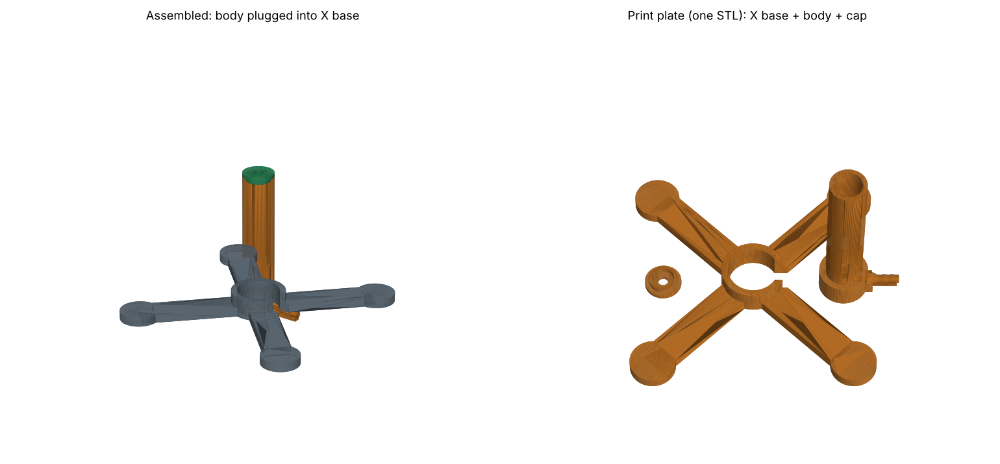

# 무게식 릴리프 — 카트리지 교체형 (12mm 구슬, FDM)

〈좌절된 성장〉 공압 회로용. 본체는 그대로 두고, **카트리지**(구슬 관 + 구멍)를 바꿔 끼워 압력 범위를 고르고, **구슬 개수**로 세밀하게 맞춰요.

## 파일
| 파일 | 수량 | 출력 방향 | 내용 |
|---|---|---|---|
| `relief_plate.stl` | — | 그대로 | **한 판 출력 파일** (아래 5개 전부) |
| `relief_base.stl` | 1 | 바닥 평평한 면을 베드에 | 본체. 꽂는 원기둥, 옆 호스 꼭지, 관(안지름 16.2), 바닥 테이퍼 구멍, 배기구 4개, 안쪽 홈 1줄 |
| `relief_cart_8p0mm.stl` | 1 | 그대로 세워서 (꼭지 아래) | 카트리지 **구멍 8mm** — 큰 모듈(30cm)용 |
| `relief_cart_5p5mm.stl` | 1 | 그대로 세워서 | 카트리지 **구멍 5.5mm** — 작은 모듈(10cm)용 |
| `relief_cap.stl` | 1 | 넓은 원판을 베드에 | 뚜껑. 눌러 끼움 |
| `relief_xbase.stl` | 1 | 그대로 눕혀서 | X자 받침. 가운데에 본체를 꽂음 |
| `relief.py` | — | — | STL 생성 스크립트 |

슬라이서에서 **호스 꼭지 아래에만 서포트**를 추가하세요. 본체와 카트리지가 높으니 브림(brim)을 켜는 게 좋아요.

## 압력표 (12mm 탄소강 구슬 약 7.1g, 계산값)
| 카트리지 | 1개 | 2개 | 3개 | 4개 | 5개 | 6개 |
|---|---|---|---|---|---|---|
| **구멍 8mm** | 1.4 | 2.8 | 4.2 | 5.5 | 6.9 | 8.3 kPa |
| **구멍 5.5mm** | 2.9 | 5.9 | 8.8 | 11.7 | 14.7 | 17.6 kPa |

- 계산식: 압력(kPa) = 총 무게(g) × 9.81 ÷ 구멍 면적(mm²). 8mm 면적 50.3, 5.5mm 면적 23.8.
- FDM은 구멍이 0.2~0.3mm 작게 나와서 실제 압력은 표보다 조금 높을 수 있어요. 구슬 개수로 맞춰요.
- 큰 모듈은 작은 모듈보다 낮은 압력이 필요해요 (대략 벽 두께 ÷ 크기에 비례). 10cm 모듈(벽 1.8mm) 테스트 값 × 0.4 정도가 30cm 모듈(벽 2.2mm)의 출발점.

## 와셔 없이 새지 않게 한 구조
- 카트리지 아래 **원뿔 모양 꼭지(테이퍼)**가 본체 바닥의 **원뿔 구멍**에 쐐기처럼 박혀요. 구슬 무게가 위에서 눌러 주니 꼭 맞물려요.
- 카트리지 밑면은 본체 바닥에서 0.8mm 떠 있게 해서, 닿는 곳이 테이퍼 한 곳뿐이에요.
- 카트리지 바깥의 **긴 돌기**가 본체 안쪽 **홈**을 따라 내려가서, 카트리지 배기구와 본체 배기구가 저절로 같은 방향에 맞춰져요.
- 돌리지 말고 **곧게 꾹** 눌러 넣어요. 그래도 샌다면 꼭지에 바셀린을 아주 얇게 발라요.

## 치수
- 본체: 관 바깥지름 21mm, 꽂는 원기둥 지름 28mm × 높이 14mm, 높이 96.5mm
- 카트리지: 바깥지름 15.7mm, 안지름 13mm(12mm 구슬 + 여유 1mm), 높이 85.7mm, 바닥 15° 깔때기, 구슬 최대 6개
- X자 받침: 팔 4개 길이 90mm(가운데부터) × 폭 18mm × 두께 6mm, 끝은 각진 모양, 전체 약 14cm
- 호스 꼭지: 바깥지름 4.6mm, 돌기 5.5mm 2개, 안구멍 3mm, 뿌리 원뿔 보강
- 한 판 크기: 약 154 × 140mm, 높이 96.5mm

## 조립
1. 본체를 X자 받침에 꽂아요 (호스 꼭지를 받침 홈에 맞춰서).
2. 원하는 카트리지를 돌기와 홈을 맞춰 위에서 넣고 꾹 눌러요.
3. 12mm 구슬을 넣어요.
4. 뚜껑을 눌러 끼워요.
5. 호스 꼭지에 실리콘 호스를 끼우고 케이블타이로 조여요.

## 테스트
- 구멍 8mm 카트리지 + 구슬 1개부터 시작해서 하나씩 늘려요.
- 구슬이 “달그락” 들리며 실리콘이 더 커지지 않으면 정상이에요.
- 카트리지를 뺄 때는 뚜껑을 열고 카트리지 윗부분을 잡고 곧게 뽑아요.

모든 값은 계산값이에요. 실제 실리콘으로 테스트하며 조정하세요.
